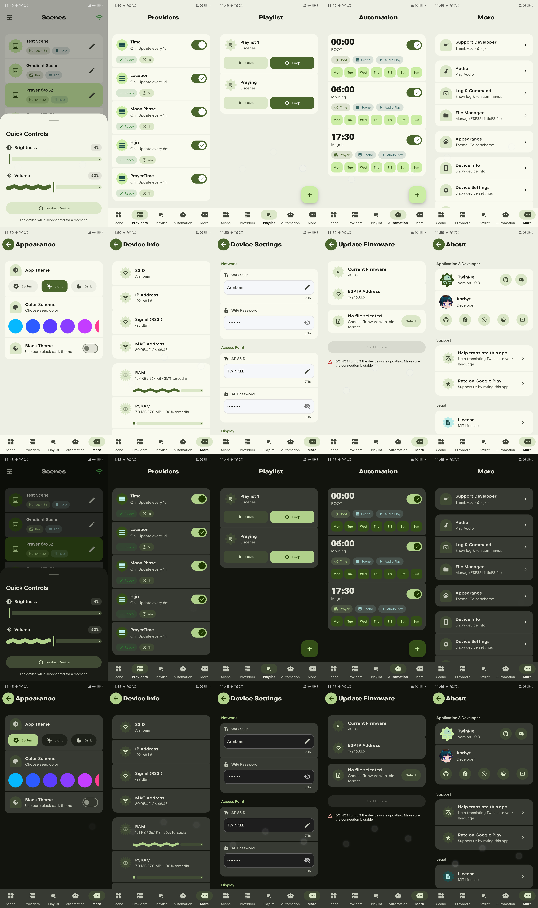
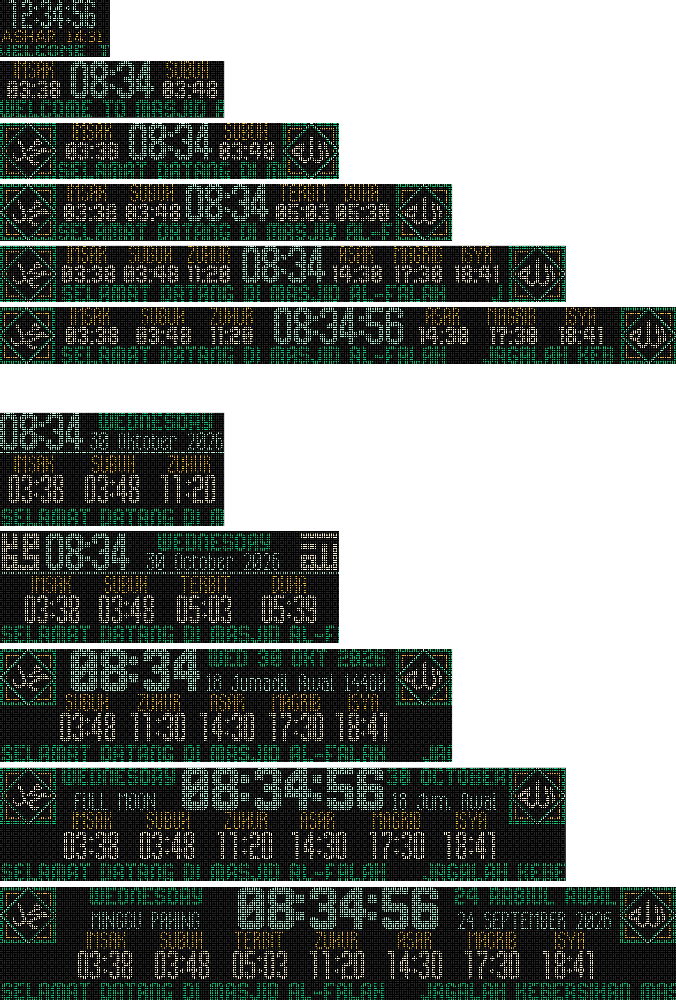
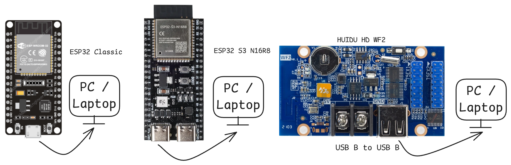
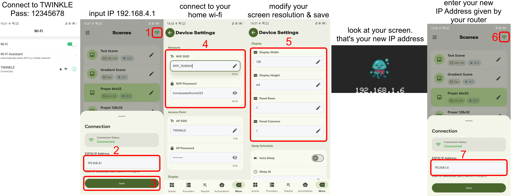

# Twinkle Firmware - ESP32

Dokumentasi singkat untuk flashing firmware Twinkle ke board ESP32.

## Screenshot App

## Screen Preview

Firmware ini mendukung:
- **ESP32 Classic**
- **ESP32-S3 N16R8**
- **Huidu HD-WF2**

---

## Download Aplikasi

- [Android APK](https://github.com/karbyt/twinkle/releases) — buka rilis **App v...**, pilih `arm64-v8a` untuk perangkat modern atau `armeabi-v7a` untuk perangkat lama.
- [Windows x64](https://github.com/karbyt/twinkle/releases) — buka rilis **App v...**, unduh file ZIP, ekstrak, lalu jalankan `twinkle.exe`.
- [Semua rilis](https://github.com/karbyt/twinkle/releases)

---

## Cara Flashing Firmware

1. Buka situs: [https://karbyt.github.io/twinkle](https://karbyt.github.io/twinkle)
2. Pilih board yang sesuai
3. Klik **Connect**
4. Klik **Install**

Tunggu hingga proses flashing selesai.

---

## Setup WiFi

Setelah firmware terinstall:

1. Buka aplikasi (APK Android atau Windows EXE)
2. Sambungkan perangkat ke WiFi **TWINKLE**  
   Password: `12345678`
3. Melalui aplikasi, ubah credential WiFi ke jaringan yang diinginkan
4. Jika berhasil, ESP32 akan mendapatkan IP address dari WiFi tersebut

IP address akan ditampilkan di layar saat proses boot.

---

## Mengontrol Device

1. Buka aplikasi
2. Di halaman Home, masukkan IP address yang ditampilkan di layar
3. Device siap dikontrol

---

## Default Pin Configuration

### ESP32 Classic

| Fungsi          | Pin |
|-----------------|-----|
| R1              | 19  |
| G1              | 13  |
| B1              | 18  |
| R2              | 5   |
| G2              | 12  |
| B2              | 17  |
| A               | 16  |
| B               | 14  |
| C               | 4   |
| D               | 27  |
| E               | 25  |
| CLK             | 2   |
| LAT             | 23  |
| OE              | 15  |
| Buzzer          | 32  |
| DFPlayer RX     | -1  |
| DFPlayer TX     | -1  |
| SCL (I2C)       | 22  |
| SDA (I2C)       | 21  |

### ESP32-S3 N16R8

| Fungsi          | Pin |
|-----------------|-----|
| R1              | 4   |
| G1              | 5   |
| B1              | 6   |
| R2              | 7   |
| G2              | 15  |
| B2              | 16  |
| A               | 18  |
| B               | 8   |
| C               | 3   |
| D               | 42  |
| E               | 38  |
| CLK             | 41  |
| LAT             | 40  |
| OE              | 39  |
| Buzzer          | 10  |
| DFPlayer RX     | 14  |
| DFPlayer TX     | 12  |
| SCL (I2C)       | 21  |
| SDA (I2C)       | 47  |

### Huidu HD-WF2

| Fungsi          | Pin |
|-----------------|-----|
| R1              | 2   |
| G1              | 6   |
| B1              | 10  |
| R2              | 3   |
| G2              | 7   |
| B2              | 11  |
| A               | 39  |
| B               | 38  |
| C               | 37  |
| D               | 36  |
| E               | 21  |
| CLK             | 34  |
| LAT             | 33  |
| OE              | 35  |
| Buzzer          | 4   |
| DFPlayer RX     | 5   |
| DFPlayer TX     | 8   |
| SCL (I2C)       | 42  |
| SDA (I2C)       | 41  |

---

## Catatan

- Pastikan board dalam mode download saat proses flashing.
- Gunakan kabel USB data (bukan charge only).
- Password WiFi default AP: `12345678` (digit 1 sampai 8).
